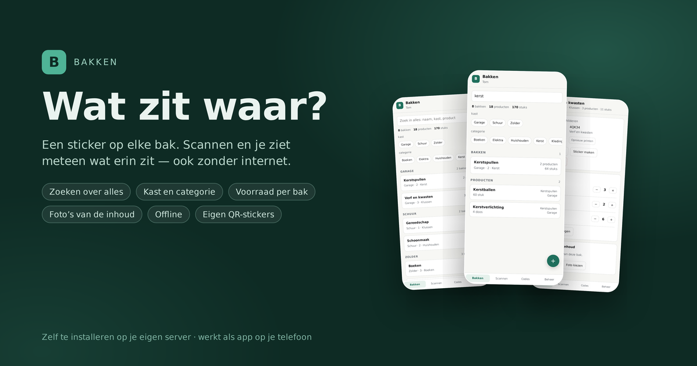
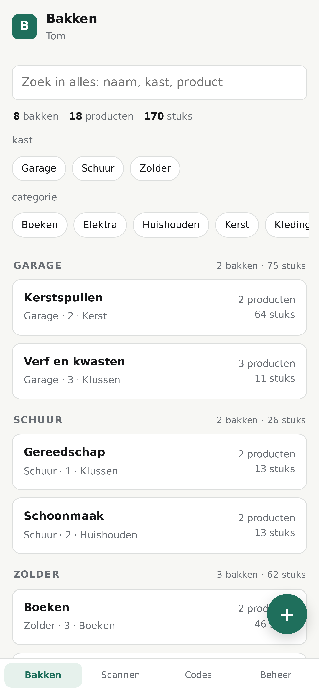
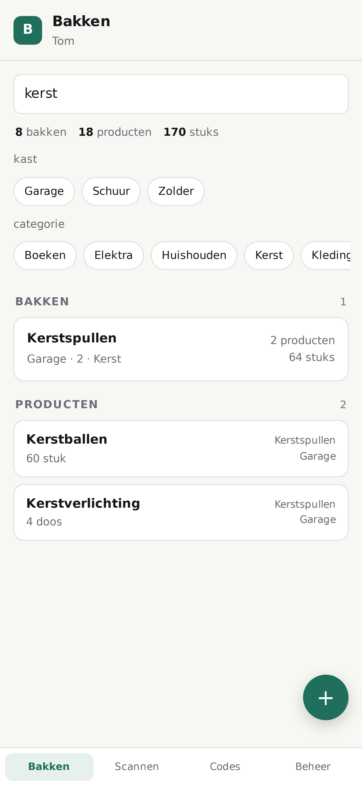
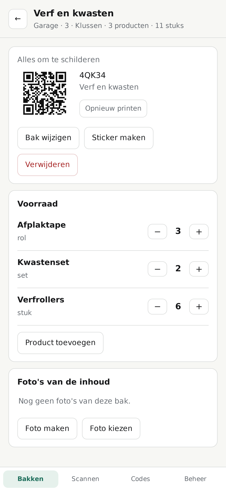
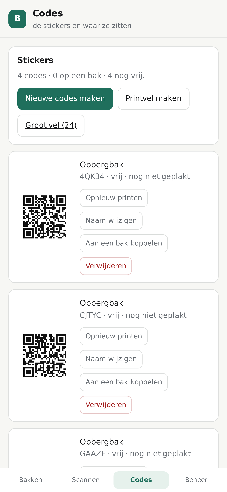
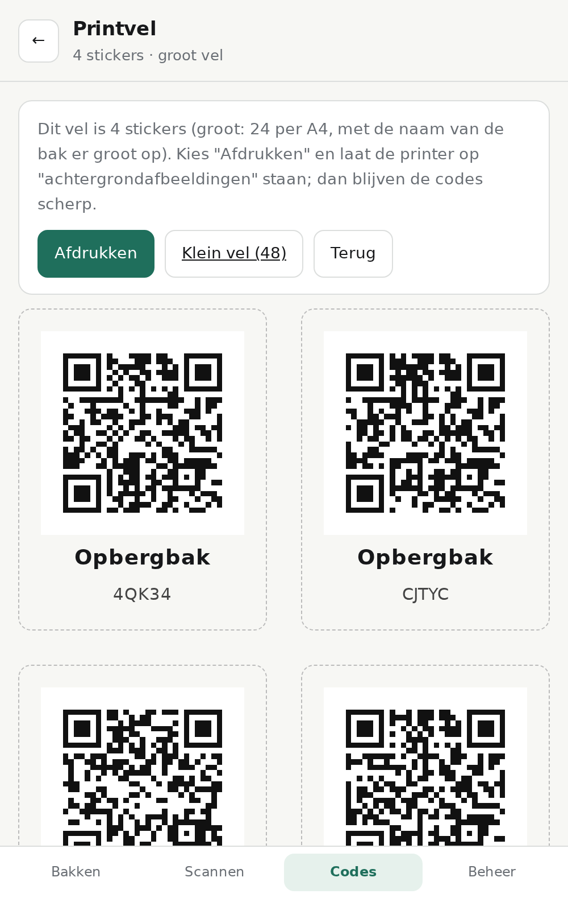
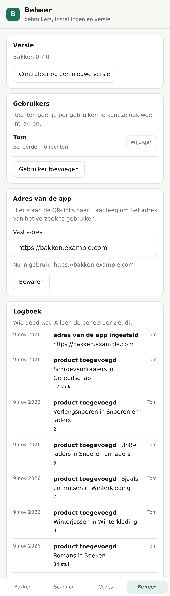
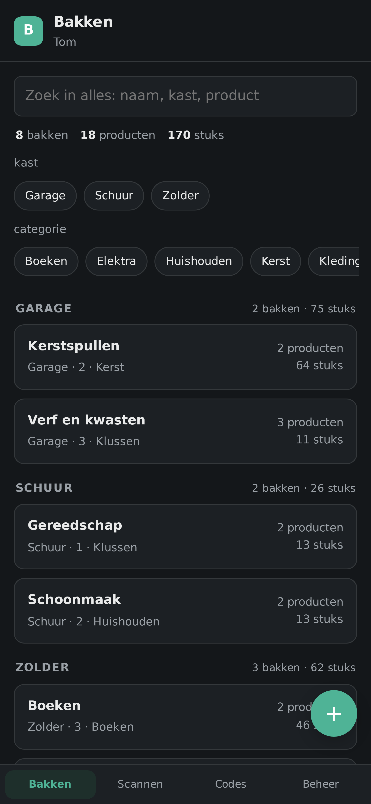

# Bakken

QR-stickers voor opbergbakken, met de voorraad per bak, foto's van de inhoud en accounts.

Je plakt een sticker op een bak, scant hem met de app en ziet meteen wat erin zit en
hoeveel ervan. De stickers maak je zelf in de app: je geeft elke code een eigen naam
(bijvoorbeeld "Garage - kerstspullen"), print een vel en plakt ze op.

## Zo ziet het eruit

  
  
  

  <em>Links: de bakkenlijst met zoeken, totalen en filters &nbsp;·&nbsp; midden: zoeken over alles &nbsp;·&nbsp; rechts: een bak met zijn sticker en voorraad</em>

  
  
  
  

  <em>Codes met een eigen naam &nbsp;·&nbsp; het grote stickervel &nbsp;·&nbsp; beheer met het logboek &nbsp;·&nbsp; de donkere modus</em>

## Wat de app doet

| Onderdeel | Wat het doet |
|---|---|
| Accounts | Inloggen met gebruikersnaam en wachtwoord; de eerste keer stel je de beheerder in. |
| Rechten | De beheerder kent rechten toe aan gebruikers (bakken bekijken, wijzigen, verwijderen, codes beheren, gebruikers beheren, bijwerken) en kan ze weer intrekken. |
| Bakken | Bakken met een naam, kast, plank, categorie, locatie en omschrijving; per bak zie je het aantal producten en het totaal aantal stuks. |
| Kast, plank en categorie | De plek is een echt gegeven in plaats van één tekstveld, met keuzelijsten uit wat er al is. De lijst groepeert per kast en je filtert op kast en categorie. |
| Voorraad per bak | Producten met een aantal, eenheid en notitie, met + en - om te tellen. |
| Zoeken over alles | Één zoekveld dat in de baknaam, de kast, de plank, de categorie, de locatie, de omschrijving én in elk product kijkt. Je ziet meteen in welke bak iets ligt. Werkt ook zonder internet. |
| Totalen | Bovenaan zie je hoeveel bakken, producten, stuks, foto's en geplakte stickers je hebt. |
| Codes | Zelf gemaakte stickers met een eigen naam, status (vrij, gedrukt, geplakt) en de printdatum, zodat je ze in de gaten kunt houden. |
| Stickervel | Klein (48 op A4) of groot (24 op A4, met de naam van de bak erbij); één sticker opnieuw printen kan vanaf de code of de bakpagina. |
| Scannen | De code uit de sticker opzoeken en meteen de bak met zijn voorraad tonen. |
| Foto's | Foto's van de inhoud van een bak, groot te bekijken met vorige/volgende, met de stand of ze al op de server staan. |
| Logboek | Wie wat deed, met de datum: bakken, producten, codes en gebruikers. Alleen de beheerder ziet het. |
| Donkere modus | De app volgt de stand van je toestel, tenzij je in Beheer iets anders kiest. |
| Offline | Wat je onderweg wijzigt gaat in een wachtrij en wordt verstuurd zodra er weer verbinding is. |
| Versiecontrole | De beheerder ziet of er iets nieuws op GitHub staat en hoe hij bijwerkt (net als bij AkkoordKast). |
| PWA | Installeren vanaf het adres van de app; de gegevens staan lokaal, dus scannen blijft werken zonder internet. |

## Over dit repo

Er staat hier **geen adres**: geen domeinnaam en geen IP-adres van de eigen omgeving,
niet in de code en niet in de geschiedenis. Het adres van de app komt van het verzoek
zelf of uit de instelling `basis_adres` op de machine (buiten dit repo). QR-links worden
met dat adres opgebouwd en de scanner leest de code uit het pad, dus geprinte stickers
blijven werken, ook als je later vanaf een ander adres print.
`test/geen-adressen.test.js` bewaakt dat automatisch.

## Draaien

Geen npm-afhankelijkheden; Node 22.5 of hoger (vanwege `node:sqlite`).

    node --test test/*.test.js     # alle proeven
    PORT=8110 node server.js       # de app zelf

Gegevens horen buiten dit repo: `DATA_DIR`, `DB_PATH` en `MEDIA_DIR` wijzen ze aan
(standaard onder `data/`, dat in `.gitignore` staat).

## Stand van zaken

- [x] Datalaag: gebruikers, sessies, bakken, producten, codes, foto's
- [x] Server: inloggen, accounts, rechten, bakken en producten, codes en scannen, versiecontrole, `/healthz`
- [x] Web-app: bakken, scannen, codes met eigen naam, beheer
- [x] QR-generator en printvel (48 stickers op A4)
- [x] PWA: manifest, pictogram, service worker met de app-schil in de cache
- [ ] PWA: foto's offline opvangen
- [x] Bijwerken vanuit de app (knop in de beheerkaart), met terugval op de host
- [x] Proxmox-installatie en Cloudflare-tunnel (zie `deploy/proxmox/README.md`)
- [x] Zoeken over alles, kast/plank/categorie, logboek, donkere modus en offline wachtrij (0.7.0)

## Installeren op je Proxmox-server

Vanaf de host (het script maakt zelf een Debian-container aan, op poort 80):

    bash -c "$(curl -fsSL https://raw.githubusercontent.com/Theberas04/bakken/main/deploy/proxmox/install.sh)"

Bijwerken kan daarna vanuit de app (knop **Bijwerken** in de beheerkaart) of vanaf de host:

    bash -c "$(curl -fsSL https://raw.githubusercontent.com/Theberas04/bakken/main/deploy/proxmox/update-from-github.sh)"

Kijken of alles goed staat, zonder iets te veranderen:

    bash -c "$(curl -fsSL https://raw.githubusercontent.com/Theberas04/bakken/main/deploy/proxmox/check-bakken.sh)"

De app op een vast https-adres zetten (nodig voor QR scannen op een telefoon):

    TOKEN=<token-uit-het-cloudflare-dashboard> bash -c "$(curl -fsSL https://raw.githubusercontent.com/Theberas04/bakken/main/deploy/proxmox/tunnel-bakken.sh)"

Gebruik een Cloudflare **named** tunnel met een vaste hostnaam; een quick tunnel geeft
elke keer een nieuwe URL en dan werken geplakte stickers niet meer. Camera en
installeren als app eisen https.
